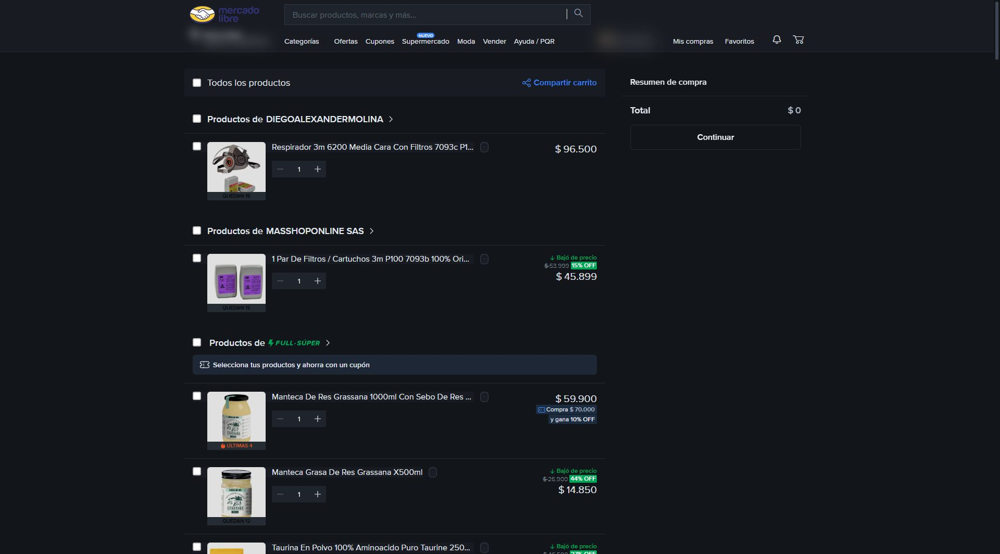
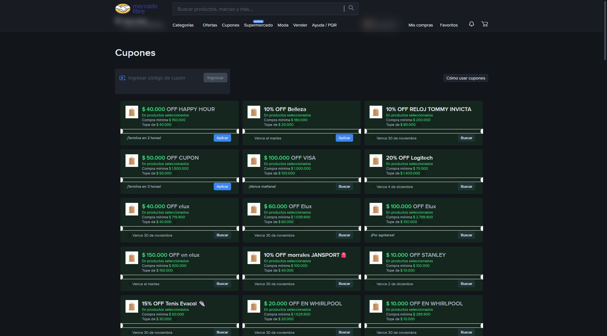

# MercadoLibre Dark (comfort)

**English** · [Español](README.es.md)

A dark theme for MercadoLibre that is actually comfortable to read for hours.

Not an inverted page. Not a `filter: invert(1)`. A real palette applied
component by component.

- **No pure black** surfaces — a low-chroma blue-grey ramp from `#12151a` to `#2e3540`
- **No pure white** text — off-white `#e3e8ef`, which avoids the halation that makes
  bright text on dark backgrounds feel harsh
- **Brand colours preserved** — MELI's green, blue, yellow and pink stay recognisable
- **Product photos untouched** — never recoloured, never inverted, only slightly dimmed
- Covers **18 MercadoLibre countries** from a single stylesheet

---

## ⚠️ Read this before configuring anything in Stylus

**Do not set the "Applies to" / "Applies to everything" option for this style.**

The stylesheet is **self-contained**. It already declares exactly which sites it
applies to through its own `@-moz-document` rule covering every MercadoLibre
country domain.

If you configure "Applies to" in Stylus, Stylus overrides that rule and starts
injecting the sheet into arbitrary documents. The classic symptom is a theme
that appears to be *half applied*: the navbar is dark on one page and light on
another, with the same sheet installed. That is not a CSS bug — the sheet is not
arriving at all.

If you see the theme working on some pages but not others, **clear the "Applies
to" setting first**. That fixes it in almost every case.

---

## Install

### Stylus (recommended)

1. Install [Stylus](https://addons.mozilla.org/firefox/addon/styl-us/) for Firefox
   or [for Chrome](https://chrome.google.com/webstore/detail/stylus/clngdbkpkpeebahjckkjfobafhncgmne).
2. Open the Stylus manager and choose **Write new style** → **Import**.
3. Drag in `dist/mercadolibre-dark.user.css`, or paste its contents.
4. Make sure the **UserCSS** toggle is on if you paste manually. Without it,
   Stylus reads `@-moz-document` as nested CSS and reports
   *"Nested @document produces broken code"*.
5. Leave **Applies to** empty. See the warning above.

The style is also published on [userstyles.world][usw], which handles updates
for you.

### Plain CSS

`dist/mercadolibre-dark.css` is the same theme without the UserCSS metadata
block. It is unscoped, so it applies to any document you inject it into — useful
for other injectors, or for a single-site setup where you control scoping
yourself.

---

## Customisation

Every colour is a token, exposed as a Stylus `@var` so it appears in the
extension's UI:

| Variable | Default | Role |
| --- | --- | --- |
| `ml-surface-0` | `#12151a` | Page background |
| `ml-surface-1` | `#181c22` | Cards and panels |
| `ml-surface-2` | `#1f242c` | Inputs, chips, hover |
| `ml-surface-3` | `#262c35` | Dropdowns and tooltips |
| `ml-text-primary` | `#e3e8ef` | Primary text |
| `ml-text-secondary` | `#a9b3c1` | Secondary text |
| `ml-text-muted` | `#7c8794` | Muted text |
| `ml-border` | `#2f3742` | Borders |
| `ml-green` | `#34d17a` | Price / shipping green |
| `ml-blue` | `#5b9bff` | Links and accents |
| `ml-blue-fill` | `#3483fa` | Brand button fill |
| `ml-yellow` | `#ffe600` | Brand yellow |
| `ml-red` | `#ff6b7a` | Danger red |
| `ml-pink` | `#ff4d94` | Promo pink |
| `ml-img-dim` | `0.88` | Product photo brightness |

`ml-img-dim` is the only one worth adjusting per taste. If product photos look
dim to you, set it to `1` (as shot). If you browse at night and want the least
glare, `0.78`.

To change the palette in the source rather than in Stylus, edit `src/tokens.css`
and rebuild.

---

## Screenshots

Home — the carousel banner keeps its own artwork and colour:


Search results — filter sidebar, brand ads and prices intact:


Product page — product photo, brand blue button, seller box:


Cart — product thumbnails visible, stock labels readable:



Coupons — the perforated band is dark with a dashed edge, not a white strip:



---

## What it covers

Verified page by page against `mercadolibre.com.co`:

- Home, category landing pages, `/categorias`
- Search results and listings, including the filter sidebar
- Product detail pages: title, price, seller box, reviews, rating histogram
- Cart, checkout steps, `/cupones`
- My account: `/my_purchases/list`, `/preguntas`, `/my-reviews`, favourites,
  subscriptions, billing
- Purchase history (`/gz/home/navigation`)
- `/ayuda` and its floating chat widget
- Seller hub: `/publicaciones`, `/resumen`
- Notification and address dropdowns and modals
- Supermarket and `/ofertas`
- Search suggestions, mega-menu, footer

---

## Known limitations

These are real boundaries, not a to-do list.

**Seller hub microfrontends use Shadow DOM.** Two of the panels in the seller
dashboard render inside shadow roots. External CSS cannot cross that boundary,
and only CSS custom properties inherit through it — which MercadoLibre does not
define. Fixing this needs a userscript that walks `shadowRoot`, not a
stylesheet. Those panels keep their light theme.

**Mercado Pago is out of scope.** It is a separate product with its own design
system, and it is not covered here. The stylesheet does not target it.

**Some embedded iframes are cross-origin.** A few checkout and payment views are
served from different origins. Where the iframe is same-origin it is themed;
where it is not, it cannot be reached from the parent document.

**MercadoLibre redeploys constantly.** Selectors here are built on design-system
component names (`andes-*`, `poly-*`, `ui-*`, `sbc-*`, `ui-navigation-*`) rather
than page-specific class chains, which is what makes them survive redesigns.
When a deploy renames a component family, that area needs a patch. Please report
it.

---

## How it works

The theme is built in layers instead of page by page, because MercadoLibre
renders the same components on every page:

```
src/tokens.css              palette — single source of truth
src/base.css                document root, scrollbars, selection, colour-scheme
src/10-header.css           top navigation, search field, user menu
src/20-cards.css            product cards, listing grid
src/30-text.css             text hierarchy
src/40-forms.css            inputs, selects, switches
src/50-coverage.css         shared andes-* primitives
src/60-search.css           search box, suggestions, result counts
src/70-pdp.css              product detail page
src/80-commerce.css         cart and checkout
src/89-andes-ui.css         andes-ui-*   (newest design-system generation)
src/90-account.css          my account, purchases, reviews, favourites
src/91-home.css             home page namespaces
src/92-landings.css         sbc-*, andes-landings-*, products-gallery-*, categories__*
src/93-styled-components.css styles__<Name> (hashed styled-components)
src/94-support.css          sc-*, myml-*, inbox-*
src/95-misc.css             coupon cards, ui-navigation-* (purchase history)
src/96-nav-extras.css       remaining navigation pieces
src/97-seller.css           seller hub
src/98-late-fixes.css       overrides that must win the cascade
src/99-iframes.css          same-origin iframe documents
```

Three rules the codebase holds to, each learned from a real bug:

1. **Every text rule sets both `color` and `-webkit-text-fill-color`.** Chrome
   and Firefox paint the latter over the former, so a rule that sets only
   `color` can look correct in a computed-style check and still render dark text.
2. **When `background-color` will not budge, use `background-image:
   linear-gradient(colour, colour)`.** MELI paints some surfaces with gradients,
   which a background-colour audit cannot see.
3. **Never use a broad, generic substring selector on a wrapper.** A generic
   styled-component name such as `styles__Wrapper` is used both for layout
   containers and for overlay layers stacked on top of product photos. Painting
   it opaque covers the photo. Generic wrappers must inherit, never paint.

---

## Build from source

```bash
node tools/build.mjs
```

Produces:

```
dist/mercadolibre-dark.css        plain CSS, no UserCSS metadata
dist/mercadolibre-dark.user.css   canonical UserCSS for Stylus / userstyles.world
dist/inject.js                    dev: inject the theme into a live page
dist/inject-off.js                dev: remove it
dist/probe.js                     dev: audit a page for contrast defects
```

The build runs two guards and **fails** rather than shipping a broken stylesheet:

- the section-wrapper at-rule must appear **exactly once** (Stylus splits a
  UserCSS by plain-text search on it — even inside a comment — and a phantom
  boundary silently kills the whole style);
- CSS comment blocks must balance (CSS has no nested comments, so a `/*` inside
  a comment swallows the rest of the file).

---

## Reporting a broken page

A report that says "page X is light" cannot be fixed. Useful reports include:

1. The **URL** and your **country**
2. A **screenshot**
3. Whether the theme is **fully** missing or **partially** applied — if the
   navbar is dark and the content is light, that is the "Applies to" problem
   above, not this stylesheet
4. If you can, the element's class list from DevTools

Most "not applied" reports are the Stylus setting. Most "white box" reports are
one uncovered component family.

---

## License

MIT — see [LICENSE](LICENSE).

Not affiliated with, endorsed by, or sponsored by MercadoLibre, Inc.
"MercadoLibre" and the MercadoLibre logo are trademarks of MercadoLibre, Inc.
This is an independent, unofficial user stylesheet and ships no MercadoLibre
assets, fonts, images or logos.

[usw]: https://userstyles.world/