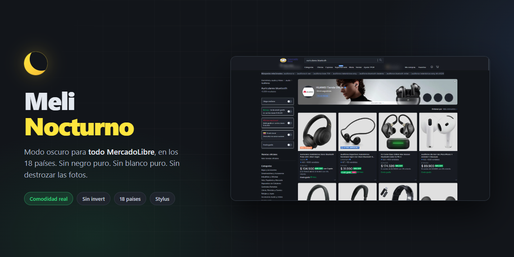
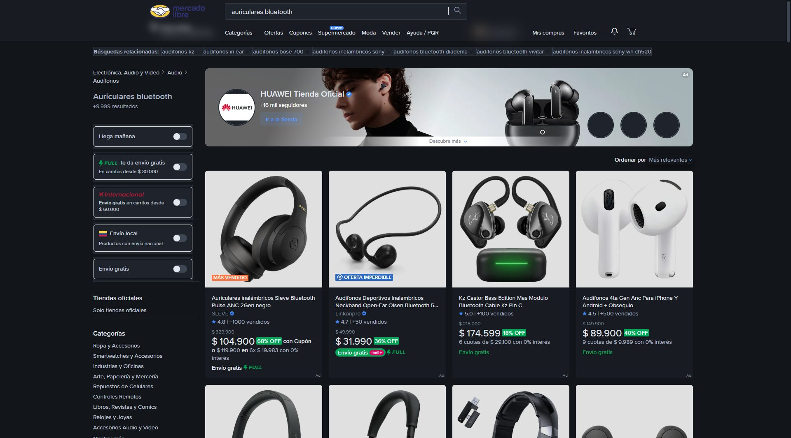
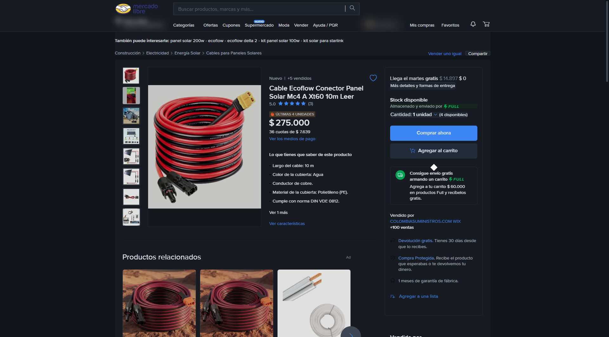

# Meli Nocturno



---

[English](README.en.md) · **Español**

Un tema oscuro para MercadoLibre pensado para leer cómodo durante horas.

No es una página invertida. No es un `filter: invert(1)`. Es una paleta real
aplicada componente por componente.

- **Sin negro puro** en superficies — una rampa azul grisácea de bajo croma, de
  `#12151a` a `#2e3540`
- **Sin blanco puro** en el texto — blanco roto `#e3e8ef`, que evita la
  halación que hace que el texto brillante sobre fondo oscuro canse la vista
- **Colores de marca intactos** — el verde, azul, amarillo y rosa de MELI siguen
  siendo reconocibles
- **Fotos de producto sin tocar** — nunca recoloreadas, nunca invertidas, apenas
  atenuadas
- Cubre **los 18 países de MercadoLibre** con una sola hoja de estilos

---

## ⚠️ Leé esto antes de configurar nada en Stylus

**No configures la opción "Applies to" (o "Se aplica a") para este estilo.**

La hoja de estilos es **autocontenida**. Ya declara exactamente a qué sitios
aplica mediante su propia regla `@-moz-document`, que cubre todos los dominios
de MercadoLibre.

Si configurás "Applies to" en Stylus, Stylus anula esa regla y empieza a
inyectar la hoja en documentos arbitrarios. El síntoma clásico es un tema que
parece **aplicado a medias**: la barra de navegación oscura en una página y
clara en otra, con la misma hoja instalada. Eso no es un bug del CSS — la hoja
no está llegando.

Si ves que el tema funciona en algunas páginas y en otras no, **primero borrá la
configuración de "Applies to"**. En casi todos los casos eso lo resuelve.

---

## Instalación

### Stylus (recomendado)

1. Instalá [Stylus](https://addons.mozilla.org/firefox/addon/styl-us/) para
   Firefox o [para Chrome](https://chrome.google.com/webstore/detail/stylus/clngdbkpkpeebahjckkjfobafhncgmne).
2. Abrí el gestor de Stylus y elegí **Write new style** → **Import**.
3. Arrastrá `dist/meli-nocturno.user.css`, o pegá su contenido.
4. Si pegás a mano, asegurate de que el interruptor **UserCSS** esté activado.
   Sin él, Stylus lee `@-moz-document` como CSS anidado y reporta
   *"Nested @document produces broken code"*.
5. Dejá **Applies to** vacío. Ver la advertencia de arriba.

El estilo también está publicado en [userstyles.world][usw], que maneja las
actualizaciones por vos.

### CSS plano

`dist/meli-nocturno.css` es el mismo tema sin el bloque de metadatos
UserCSS. No tiene scoping, así que se aplica a cualquier documento donde lo
inyectes — útil para otros inyectores, o para un setup de un solo sitio donde
vos controlás el scoping.

---

## Personalización

Cada color es un token, expuesto como `@var` de Stylus para que aparezca en la
interfaz de la extensión:

| Variable | Por defecto | Rol |
| --- | --- | --- |
| `ml-surface-0` | `#12151a` | Fondo de página |
| `ml-surface-1` | `#181c22` | Tarjetas y paneles |
| `ml-surface-2` | `#1f242c` | Inputs, chips, hover |
| `ml-surface-3` | `#262c35` | Desplegables y tooltips |
| `ml-text-primary` | `#e3e8ef` | Texto principal |
| `ml-text-secondary` | `#a9b3c1` | Texto secundario |
| `ml-text-muted` | `#7c8794` | Texto atenuado |
| `ml-border` | `#2f3742` | Bordes |
| `ml-green` | `#34d17a` | Verde de precio / envío |
| `ml-blue` | `#5b9bff` | Enlaces y acentos |
| `ml-blue-fill` | `#3483fa` | Relleno de botón de marca |
| `ml-yellow` | `#ffe600` | Amarillo de marca |
| `ml-red` | `#ff6b7a` | Rojo de peligro |
| `ml-pink` | `#ff4d94` | Rosa promocional |
| `ml-img-dim` | `0.88` | Brillo de fotos de producto |

`ml-img-dim` es el único que vale la pena ajustar al gusto. Si las fotos te
parecen apagadas, ponelo en `1` (tal cual la foto). Si navegás de noche y querés
el mínimo brillo, `0.78`.

Para cambiar la paleta en el código fuente y no en Stylus, editá
`src/tokens.css` y reconstruí.

---

## Capturas

Home — el banner del carrusel conserva su arte y su color:


Resultados de búsqueda — barra de filtros, anuncios de marca y precios intactos:



Página de producto — foto del producto, botón azul de marca, caja del vendedor:



Carrito — miniaturas visibles, etiquetas de stock legibles:


Cupones — la banda perforada es oscura con borde punteado, no una tira blanca:


---

## Qué cubre

Verificado página por página contra `mercadolibre.com.co`:

- Home, páginas de categoría, `/categorias`
- Resultados de búsqueda y listados, incluida la barra lateral de filtros
- Página de producto: título, precio, caja del vendedor, opiniones, histograma
  de puntuaciones
- Carrito, pasos de checkout, `/cupones`
- Mi cuenta: `/my_purchases/list`, `/preguntas`, `/my-reviews`, favoritos,
  suscripciones, facturación
- Historial de compras (`/gz/home/navigation`)
- `/ayuda` y su widget de chat flotante
- Central de vendedores: `/publicaciones`, `/resumen`
- Desplegables y modales de notificaciones y direcciones
- Supermercado y `/ofertas`
- Sugerencias de búsqueda, mega-menú, footer

---

## Límites conocidos

Son límites reales, no una lista de pendientes.

**Los microfrontends de la central de vendedores usan Shadow DOM.** Dos de los
paneles del panel de vendedor se renderizan dentro de shadow roots. El CSS
externo no puede cruzar esa frontera, y por ella solo heredan las propiedades
personalizadas de CSS — que MercadoLibre no define. Arreglar esto requiere un
userscript que recorra `shadowRoot`, no una hoja de estilos. Esos paneles
conservan su tema claro.

**Mercado Pago queda fuera de alcance.** Es un producto separado con su propio
sistema de diseño, y no está cubierto. La hoja no lo apunta.

**Algunos iframes embebidos son cross-origin.** Algunas vistas de checkout y
pago se sirven desde otros orígenes. Donde el iframe es same-origin se tematiza;
donde no lo es, no se puede alcanzar desde el documento padre.

**MercadoLibre redeploya constantemente.** Los selectores acá están construidos
sobre nombres de componentes del sistema de diseño (`andes-*`, `poly-*`, `ui-*`,
`sbc-*`, `ui-navigation-*`) en vez de cadenas de clases específicas de página,
que es lo que los hace sobrevivir a los rediseños. Cuando un deploy renombra una
familia de componentes, esa zona necesita un parche. Reportalo.

---

## Cómo funciona

El tema está construido en capas en vez de página por página, porque
MercadoLibre renderiza los mismos componentes en todas las páginas:

```
src/tokens.css              paleta — única fuente de verdad
src/base.css                raíz del documento, scrollbars, selección, colour-scheme
src/10-header.css           navegación superior, buscador, menú de usuario
src/20-cards.css            tarjetas de producto, grilla de listado
src/30-text.css             jerarquía de texto
src/40-forms.css            inputs, selects, switches
src/50-coverage.css         primitivas andes-* compartidas
src/60-search.css           buscador, sugerencias, conteo de resultados
src/70-pdp.css              página de producto
src/80-commerce.css         carrito y checkout
src/89-andes-ui.css         andes-ui-*   (generación más nueva del design system)
src/90-account.css          mi cuenta, compras, opiniones, favoritos
src/91-home.css             namespaces del home
src/92-landings.css         sbc-*, andes-landings-*, products-gallery-*, categories__*
src/93-styled-components.css styles__<Nombre> (styled-components con hash)
src/94-support.css          sc-*, myml-*, inbox-*
src/95-misc.css             tarjetas de cupón, ui-navigation-* (historial de compras)
src/96-nav-extras.css       piezas restantes de navegación
src/97-seller.css           central de vendedores
src/98-late-fixes.css       overrides que deben ganar la cascada
src/99-iframes.css          documentos de iframes same-origin
```

Tres reglas que respeta el código, cada una aprendida de un bug real:

1. **Toda regla de texto define `color` y `-webkit-text-fill-color`.** Chrome y
   Firefox pintan la segunda por encima de la primera, así que una regla que
   solo define `color` puede verse correcta al inspeccionar estilos computados y
   aun así renderizar texto oscuro.
2. **Cuando `background-color` no cede, usar `background-image:
   linear-gradient(color, color)`.** MELI pinta algunas superficies con
   gradientes, que una auditoría de background-color no puede ver.
3. **Nunca usar un selector de subcadena amplio y genérico sobre un wrapper.** Un
   nombre genérico de styled-component como `styles__Wrapper` se usa tanto para
   contenedores de layout como para capas de overlay apiladas encima de las
   fotos de producto. Pintarlo opaco tapa la foto. Los wrappers genéricos deben
   heredar, nunca pintar.

---

## Compilar desde el código fuente

```bash
node tools/build.mjs
```

Genera:

```
dist/meli-nocturno.css        CSS plano, sin metadatos UserCSS
dist/meli-nocturno.user.css   UserCSS canónico para Stylus / userstyles.world
dist/inject.js                    dev: inyecta el tema en una página viva
dist/inject-off.js                dev: lo quita
dist/probe.js                     dev: audita defectos de contraste en una página
```

El build corre dos guards y **falla** en vez de publicar una hoja rota:

- la at-rule que envuelve las secciones debe aparecer **exactamente una vez**
  (Stylus parte un UserCSS por búsqueda de texto plano de esa cadena — incluso
  dentro de un comentario — y una frontera fantasma mata el estilo entero en
  silencio);
- los bloques de comentario CSS deben balancear (CSS no soporta comentarios
  anidados, así que un `/*` dentro de un comentario se come el resto del
  archivo).

---

## Cómo reportar una página rota

Un reporte que dice "la página X está clara" no se puede arreglar. Los reportes
útiles incluyen:

1. La **URL** y tu **país**
2. Una **captura de pantalla**
3. Si el tema falta **por completo** o está **aplicado a medias** — si la barra
   de navegación está oscura y el contenido claro, ese es el problema de
   "Applies to" de arriba, no esta hoja
4. Si podés, la lista de clases del elemento desde DevTools

La mayoría de los reportes de "no aplica" son la configuración de Stylus. La
mayoría de los reportes de "caja blanca" son una familia de componentes sin
cubrir.

---

## Licencia

MIT — ver [LICENSE](LICENSE).

Sin afiliación, respaldo ni patrocinio de MercadoLibre, Inc. "MercadoLibre" y el
logo de MercadoLibre son marcas de MercadoLibre, Inc. Esta es una hoja de
estilos de usuario independiente y no oficial, y no incluye assets, tipografías,
imágenes ni logos de MercadoLibre.

[usw]: https://userstyles.world/